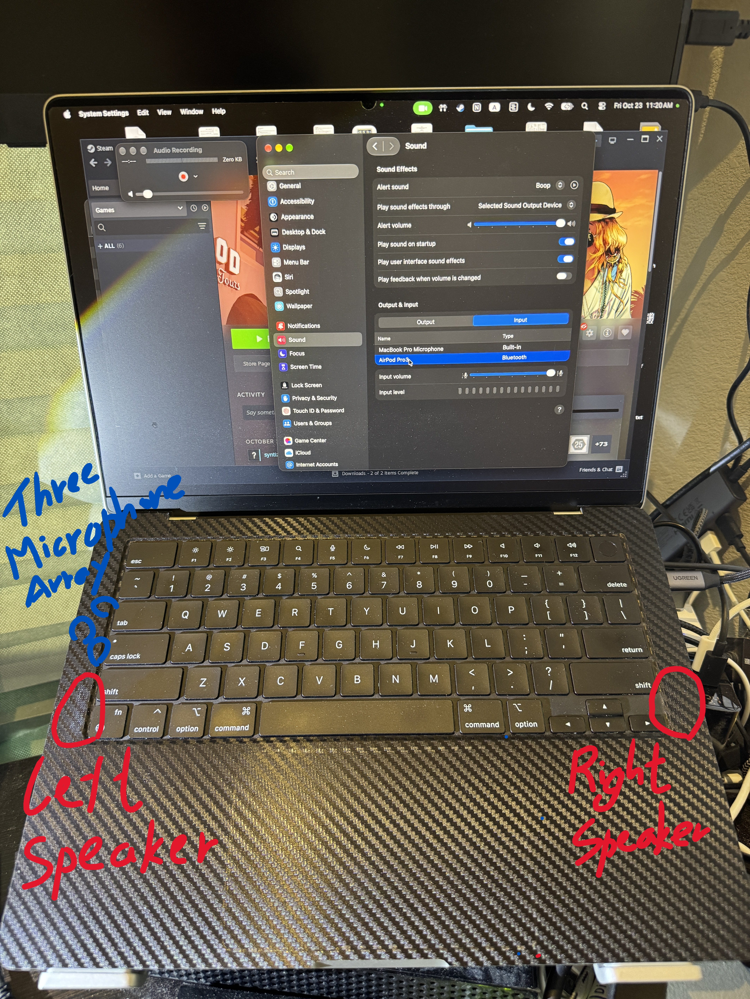
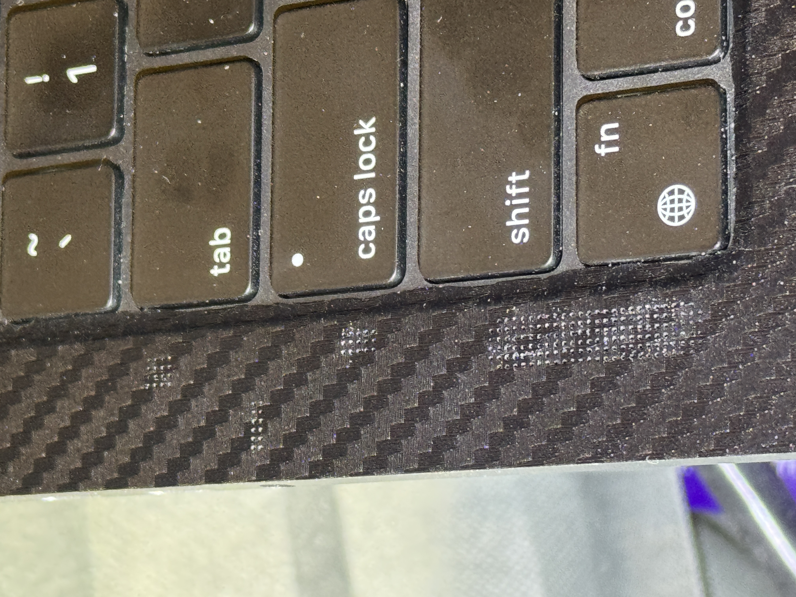
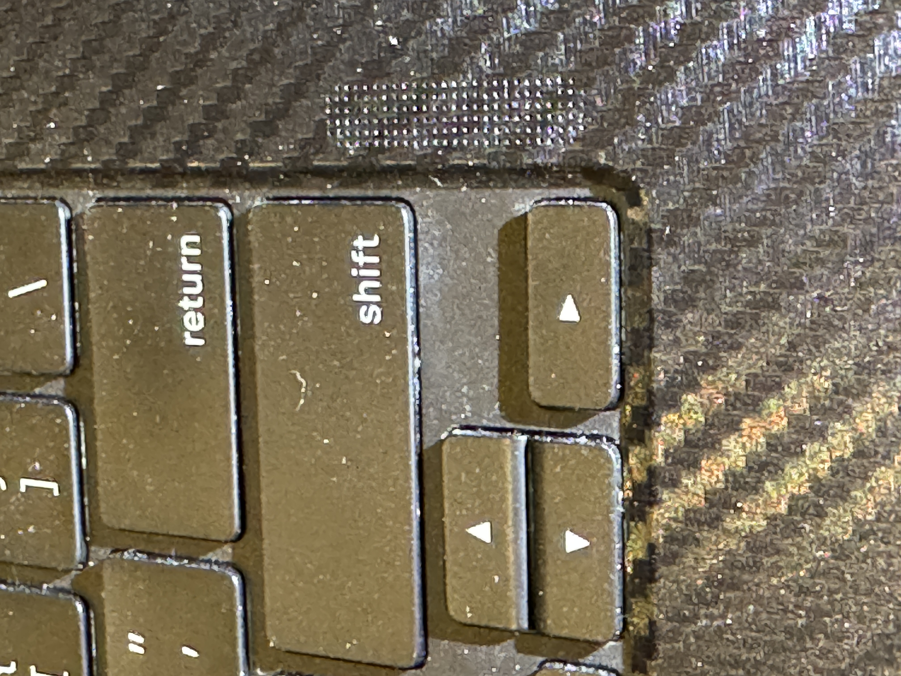

# How to Identify Speaker and Microphone Holes on a 14-inch MacBook Pro M4 Pro Before Applying a Carbon Fiber Vinyl Wrap

**Device:** 14-inch Apple MacBook Pro with M4 Pro  
**Modification:** Carbon-fiber-texture vinyl wrap on the keyboard deck  
**Purpose:** Documenting how I investigated the speaker grille and built-in microphone opening locations before applying a laptop skin.

## Overview

I purchased a silver-finish 14-inch MacBook Pro with the M4 Pro chip and decided to customize its appearance by applying a carbon-fiber-texture vinyl wrap to the inner surface around the keyboard.

A practical concern is that the wrap could cover the speaker grille perforations or microphone openings. I therefore examined the keyboard deck, photographed the left and right sides, and used QuickTime Player to help investigate the built-in microphone's pickup area.

The photographs below document the laptop and the areas I inspected. The exact mapping of each individual microphone pinhole should be treated as an estimate unless independently confirmed.

## 1. MacBook Pro M4 Pro with Carbon-Fiber-Texture Vinyl Wrap

*Figure 1. Overall view of the laptop with the wrap. The speaker grille areas and the area investigated for the microphone array are highlighted for reference.*

The areas of interest are:

- **Speaker grilles:** The perforated areas along the left and right sides of the keyboard deck.
- **Microphone array:** The built-in microphone openings are tiny and can be difficult to distinguish visually from nearby perforations.

Not every small hole should automatically be assumed to be a microphone opening.

## 2. Detailed View of the Left-Hand-Side Holes

*Figure 2. Close-up view of the left-hand-side holes and the area investigated for the built-in microphone array.*

The left side needed particular attention because I wanted to distinguish the speaker grille from the area associated with the microphone array. Visual inspection alone can make this difficult, so I also performed an audio recording test.

## 3. How I Investigated the Microphone Location Using QuickTime Player

To investigate the microphone's location without opening the laptop, I used my AirPods and QuickTime Player on macOS.

### Procedure

1. **Connect the AirPods.** I put on my AirPods and connected them to the MacBook Pro.
2. **Open QuickTime Player.** I selected **File → New Audio Recording**.
3. **Select the audio devices.** I used the AirPods for audio output and selected the MacBook Pro's built-in microphone as the recording input.
4. **Test the built-in microphone.** With the MacBook's microphone selected as the input, I spoke toward different areas of the laptop and listened to or compared the recorded audio.
5. **Narrow down the area.** Comparing the pickup response helped me investigate the general area associated with the built-in microphone array and inspect the tiny openings more closely.

### Why this method helps

The important step is to select the MacBook Pro's built-in microphone as the recording input rather than the AirPods' microphone. The AirPods can be used for playback while QuickTime records from the MacBook.

**Limitation:** This test can help investigate the general pickup area, but it does not by itself prove which individual pinhole corresponds to each microphone. Sound can reach a microphone from different directions, so I treated the result as a location estimate and combined it with close-up visual inspection.

## 4. Detailed View of the Right-Hand-Side Speaker Holes

*Figure 3. Close-up view of the right-hand-side speaker grille perforations.*

The right-hand-side grille is another area to consider when trimming and fitting the vinyl wrap. Covering speaker openings may affect acoustic performance, so keeping the perforations unobstructed is preferable to applying a continuous layer of film over them.

## 5. Key Considerations When Applying a Vinyl Wrap

1. **Identify openings before installation.** Examine the keyboard deck under good lighting and take close-up photographs.
2. **Distinguish grilles from microphone openings.** Do not assume every perforation is a microphone.
3. **Use an audio recording test.** Select the MacBook's built-in microphone as QuickTime's recording input to investigate the pickup area.
4. **Avoid covering acoustic openings.** Vinyl covering the relevant perforations may affect speaker sound or microphone pickup.
5. **Trim carefully.** Where practical, needle punch the wrap around the openings instead of leaving film over them.
6. **Test after installation.** Check speaker playback and microphone recording for noticeable changes.

## Conclusion

A carbon-fiber-texture vinyl wrap is one way to customize the appearance of a silver 14-inch MacBook Pro M4 Pro. Before applying it, however, it is worth locating the acoustic openings and taking care not to obstruct them.

By documenting the overall layout, photographing both sides, and using QuickTime Player with the MacBook's built-in microphone selected as the input, I investigated the microphone pickup area without disassembling the laptop. I hope this documentation helps other MacBook Pro owners planning a similar modification.

---

### Keywords

MacBook Pro M4 Pro, 14-inch MacBook Pro, carbon fiber vinyl wrap, CFRP texture laptop skin, MacBook keyboard deck wrap, MacBook speaker grille holes, MacBook microphone location, three-microphone array, QuickTime audio recording, MacBook built-in microphone test, laptop skin installation, MacBook Pro customization.
